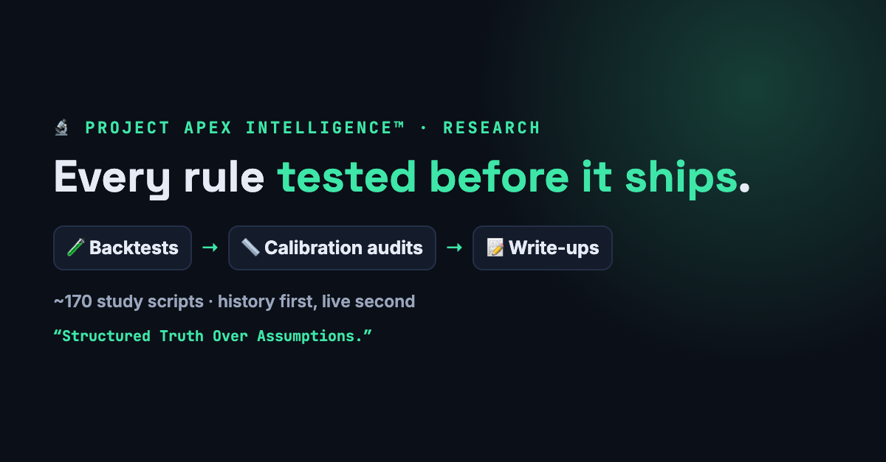

<p align="center"><a href="https://demetriusreynolds251-maker.github.io/apex/"></a></p>
<p align="center"><a href="https://demetriusreynolds251-maker.github.io/apex/"><b>▶ Take the Apex Intelligence™ tour</b></a></p>

# apex-tennis-research

The research behind the tennis rules: backtests, calibration audits, model experiments and the written reports that came out of them. Each live rule in `apex-tennis` was checked here first against saved results.

> **Note:** Designed and directed by Demetrius Reynolds and built with AI coding assistants. I understand the code and architecture but am not a professional software engineer.

## The Apex system

Apex is a personal hobby project that prices player props (PrizePicks / ParlayPlay style "more or less" lines) by comparing a model probability with sportsbook prices, then posts ranked boards and results to private Discord channels. It is split into these repos:

| Repo | Role |
|---|---|
| `apex-tennis` | Live tennis system: scheduler, model, boards, grading, Discord bot, dashboard |
| `apex-tennis-warehouse` | Collector that keeps the tennis match/stats database up to date |
| `apex-tennis-research` | Backtests, audits and write-ups behind the tennis rules |
| `apex-multisport` | Same idea for other sports (NBA, NFL, NHL, soccer and more), separate from tennis |

Nothing here places bets. It is research and alerting only.

## What is in here

| Folder | What it holds |
|---|---|
| `studies/` | About 170 one-off scripts: backtests, calibration and dispersion audits, Elo and feature-value tests, model v2 experiments |
| `patches/` | Scripts that applied a reviewed change to a live file. Each one checks the file's SHA-256 first and refuses to run if the file changed (those hashes are the long hex strings) |
| `reports/` | Markdown write-ups: investigations, design notes, deployment notes |
| `apex_learning_system/` | Daily findings, change log and recommendations from the automated learning job |

About 340 files and 35,000 lines of Python. These are historical scripts kept for the record. Most import modules from `apex-tennis` and need its data, so they are for reading more than running.

## Tech

Python 3.9+, numpy, pandas, scipy, scikit-learn, xgboost, SQLite.

## Running a study (placeholders)

```bash
pip install -r requirements.txt
export APEX_HOME=/path/to/apex-tennis      # a checkout of apex-tennis with data
PYTHONPATH=$APEX_HOME python3 studies/<script>.py
```

## License

[Apex Share-Back License 1.1](LICENSE): free to use, study and build on for non-commercial purposes. If you use it, you agree to share your findings and improvements back publicly and for free and credit "Based on Apex by Demetrius Reynolds". Selling it or using it in a paid product needs a written commercial license: [ask on LinkedIn](https://www.linkedin.com/in/demetrius-reynolds/). See the [terms on the site](https://demetriusreynolds251-maker.github.io/apex/#share).
